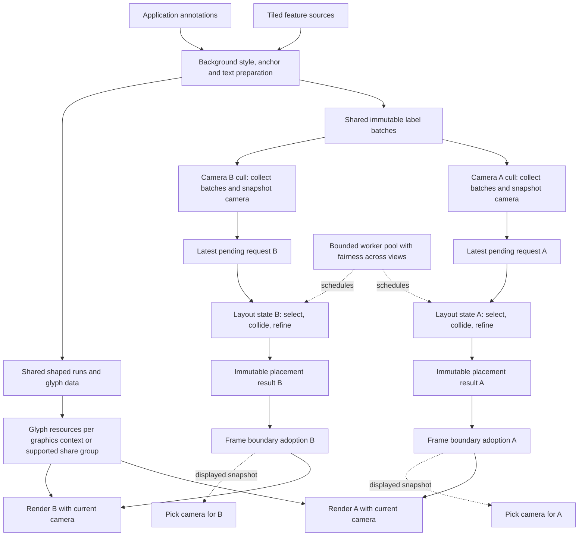

# Label engine design

November 8, 2026. Status: private scheduling/data core, initial Slughorn rendering, and background greedy
decluttering are implemented. The demo renders independently decluttered text in two cameras, with per-view
placement history, per-label fades, bounded exit reservations, motion compatibility checks, and on-demand frame
demand. Iterative regional refinement remains planned. See the implementation plan for checks and remaining gates.

Build a successor to the PlaceNode, LabelNode, ScreenSpaceLayout, and osgText-based map labeling pipeline.
Use immutable spatial batches, asynchronous placement per view, and batched Slughorn glyph rendering.
The implementation sequence and acceptance gates are in [the implementation plan](label-engine-plan.md).

All new labeling code belongs to the `osgEarthPrestige` nodekit, in the `osgEarthPrestige::Labeling` namespace.
The nodekit owns records, background scheduling and placement, text preparation, rendering, and future tiled
integration and callouts. It depends on core osgEarth; core osgEarth does not depend on this engine. Current
prototype headers remain private and uninstalled. The Slughorn renderer requires `OSGEARTH_ENABLE_SLUGHORN`;
disabling `OSGEARTH_BUILD_PRESTIGE_NODEKIT` excludes the new engine and its demo entirely.

## Requirements and scope

The first release covers tiled point labels, dynamic application annotations, icons, backgrounds, and callouts.
International text, geographic precision, stable tile transitions, picking, and independent camera layouts are
core requirements. Reserve room for line and polygon placement, but defer curved road labels and richer polygon
placement until the point-label path proves its quality and scalability.

The new engine has its own collision domain. It does not coordinate collisions, visibility, or callouts with
legacy text components. Existing components can coexist in a scene, but their labels may overlap new labels.
Translate useful existing style concepts without making legacy drawable manipulation or RenderLeaf comparators
part of the new API. Compatibility adapters are optional follow-on work.

The following are architectural invariants:

- No per-feature scene-graph subtree or per-glyph drawable on the bulk path.
- Cull and draw never wait for layout, shaping, tile preparation, or a worker-held scene lock.
- Placement belongs to a view. A label has no global visibility, screen offset, or animation state.
- Rendering projects accepted anchors with the current camera, even when placement decisions are older.
- Worker input and output are immutable snapshots with explicit identity and lifetime validation.
- Work queues, candidate counts, refinement effort, cache memory, and retained snapshots have finite budgets.
- Geographic calculations retain double precision until rebasing or conversion to screen coordinates.

## Motivation and reference behavior

[BuildTextFilter](../../src/osgEarth/BuildTextFilter.cpp) creates a PlaceNode for each feature on its normal path.
[ScreenSpaceLayoutDeclutter](../../src/osgEarth/ScreenSpaceLayoutDeclutter) sorts render leaves, scans accepted
rectangles for overlap, creates replacement model-view matrices, and draws leaves individually. Callouts use a
separate substantial implementation in [ScreenSpaceLayoutCallout](../../src/osgEarth/ScreenSpaceLayoutCallout).
These are structural observations, not measurements of their contribution to a particular application's frame time.

Rocky demonstrates the desired separation between rendering and periodic decluttering. At inspected revision
`e9bdbcc7c0a68f69e707ef4901d4e51dbab351a9`, its
[demo](https://github.com/pelicanmapping/rocky/blob/e9bdbcc7c0a6/src/apps/rocky_demo/Demo_Decluttering.h)
runs a background worker at a configurable 1 to 30 Hz, defaulting to 1 Hz. Its
[solver](https://github.com/pelicanmapping/rocky/blob/e9bdbcc7c0a6/src/rocky/vsg/ecs/DeclutterSystem.cpp)
uses recent per-view transforms, priority or depth ordering, and an R-tree to select nonoverlapping rectangles.
Each update rebuilds the solution. This proposal adopts background scheduling and adds immutable handoff,
bounded incremental refinement, explicit stale-result policies, and tile-aware identity.

## Architecture

The names below are provisional responsibilities, not a commitment to exported C++ classes.

| Component | Responsibility |
| --- | --- |
| LabelLayer | Feature-source, style, paging, and policy integration |
| LabelBatch | Immutable records and spatial bounds for a tile or other spatial group |
| LabelHandle | Stable application-facing identity for creating, updating, and removing annotations |
| LabelEngine | View registration, snapshot exchange, scheduling, and result adoption |
| LayoutSolver | Renderer-independent selection, collision resolution, and callout refinement |
| TextService | Font selection, Unicode processing, shaping, metrics, and glyph caching |
| LabelRenderer | Batched rendering and picking using accepted placements |

## Data and ownership

A label record contains an identity, content revision, geographic anchor, shaped-run reference, style reference,
optional icon and background, priority, scale/range eligibility, placement alternatives, collision policy,
and picking identity. Text, icon, and background form an explicit placement unit. Policies can permit the icon
to remain when its text is hidden, but this is deliberate behavior rather than a scene-graph sibling side effect.

Use a stable key such as source namespace, layer, feature identity, and label role. Keep content revisions separate
from identity so history survives harmless content or tile changes. Tile ownership is also separate from identity.
Without stable feature IDs, define a deterministic source-specific fallback and its limitations. Equal strings
must not globally merge different places. World-wrap instances require separate instance identity when both can
appear in one view; suppress duplicate tile representations of the same instance.

Batches own immutable arrays and shared references to prepared CPU resources. Dynamic edits publish replacement
records or small batches through a bounded update mechanism. Worker-local font objects and solver scratch space
must not be exposed to rendering. Changes to terrain height, text metrics, or collision geometry revise the record.

The current dynamic implementation allocates stable slots in chunks of 64, independently of feature-ID sorting.
Only dirty chunks are captured/prepared; a generation atomically publishes the full vector of chunk references.
The renderer caches immutable chunk/page packets per view, including accepted membership and fade descriptors.
Unchanged static/tiled selections remain merged by atlas page. Reused packets keep their own time origin and
frame-local draw state, preserving independent camera adoption clocks without mutating in-flight glyph buffers.
Chunking bounds sparse rebuild work at the cost of more dynamic draw packets; it does not make decluttering
incremental or promise an exact one-glyph GPU subrange update.

Frame snapshots retain resources needed by in-flight draw operations. Tile eviction cancels unnecessary work and
removes eligibility, but cannot free data still used by a worker or renderer. Retired GPU resources are reclaimed
only after the appropriate context's in-flight work completes. Bound the number and bytes of retired snapshots;
apply backpressure to preparation rather than blocking cull or allowing unlimited retained tile data.

## Views, cameras, and graphics contexts

Register an explicit ViewKey with a generation. A camera pointer is an attachment, not durable identity.
Every independent placement view owns these items:

- Camera and viewport snapshots, including viewport origin, dimensions, device-pixel ratio, projection,
  relevant reference frame, time, and configuration revision.
- Visible batch references, latest pending request, and at most one active solve.
- Candidate ordering, collision index, previous choices, callout refinement, and convergence state.
- Published and displayed results, fade/offset transitions, and layout statistics.

Express style sizes in logical pixels and resolve them to physical viewport pixels consistently for projection,
collisions, rendering, and picking. Include viewport origin in coordinate conversion. Capture coherent per-view
camera state rather than consulting a global main camera. Changes to viewport or projection conventions cause a
view configuration revision and require fresh layout; ordinary camera movement uses pose compatibility checks.

Two cameras viewing the same labels may choose different placements and visibility. They may share immutable
content and glyph data, but never accidentally share mutable placement or fade state. Camera destruction retires
its ViewKey generation, cancels pending work, and rejects late publications. Pointer reuse cannot revive old state.

A picking camera explicitly references its source view and uses the displayed placement and animation snapshot.
It transforms that snapshot into the pick viewport instead of running decluttering. A pick after camera movement
must use the corresponding displayed frame, not an independently sampled camera pose. Unrelated render-to-texture
cameras opt in as independent views or opt out of labels; do not register every traversal automatically.

Stereo grouping is explicit and optional. A group can share selection and placement alternatives while using
eye-specific anchor projection. Group admission must account for both eyes' visibility and collision footprints;
independently solving the eyes risks binocular inconsistency. Independent monocular views are the first milestone;
stereo support has its own acceptance gate before it is advertised.

GPU allocation is keyed separately by graphics context or a verified resource-sharing group. Multiple views can
share a context, and one placement result can be rendered in multiple compatible contexts. Each context validates
resource readiness and uses the same policy for missing resources in drawing and picking.

## Asynchronous placement lifecycle

1. Paging and annotation preparation evaluate styles, resolve anchors, shape text, and publish batches.
2. Cull performs coarse spatial filtering and collects batch references in reusable storage. It captures camera
   state and posts the newest snapshot for that view. It does not project every candidate or resolve collisions.
3. The scheduler runs a solve using an immutable snapshot. Workers project and filter individual candidates.
4. The solver publishes a complete, coherent initial placement, then may publish improved solutions in bounded
   slices. An arbitrary partial rectangle set must not masquerade as a complete solution.
5. At a defined traversal-safe frame boundary, the engine adopts a compatible result without waiting for a worker.
   The current frame pins its displayed result so concurrent cull/draw and pick operations cannot see mixed state.
6. Rendering projects accepted anchors with the current view, applies chosen screen offsets and transitions,
   and emits batched text, icons, backgrounds, and leaders.

The OSG integration spike must establish the exact update/cull/render-stage hook and ownership handoff. A cull
snapshot normally feeds a later frame. Do not modify shared scene data during sort callbacks or let a worker touch
RenderLeaf pointers, live traversal matrices, OSG State, or GL objects. Use a bounded mailbox or equivalent handoff
whose rendering-side operation never waits for worker progress. Move expensive reclamation off that operation.

Each view has one active solve and one replaceable pending snapshot. New camera samples replace pending input.
Do not cancel all work on every camera update: finish a bounded useful slice, publish if compatible, then retarget.
Hard invalidations such as view destruction cancel immediately at safe checkpoints. Schedule slices fairly across
views under a global CPU/concurrency budget; there is no requirement for one OS thread per camera.

Wake for meaningful camera motion, changed batches, styles, anchors, viewport state, or unfinished refinement.
When settled, sleep. While moving, use a configurable maximum solve cadence and bounded slices. Do not fix Rocky's
demo frequency as this engine's default without measurement. A newly selected label can request an urgent solve,
but urgency does not create an unbounded queue or a synchronous cull fallback. Publication requests a frame for
on-demand viewers; request subsequent animation frames only while transitions remain active.

## Result compatibility and motion

A placement result carries ViewKey generation, configuration revision, sampled pose/time, input batch and record
revisions, and a monotonically ordered publication identity. It contains accepted label identities, alternatives,
offset targets, visibility targets, and resource references. Results cannot overwrite a newer adopted publication.

Distinguish hard invalidation from normal age:

- Reject results for a destroyed view or incompatible viewport/projection configuration.
- Remove deleted or materially changed records by generation/revision. Revalidate compatible records individually;
  unrelated tile arrivals must not invalidate all useful placement for a view.
- Permit older camera poses when displacement and age remain within policy. Exact frame equality would starve
  publication during continuous movement. Check conservative projected movement of the accepted set or a bounded
  representative set, together with hard camera-change rules; calibrate thresholds in the motion experiments.
- On a large jump or expired result, suppress or fade unsuitable placements and request fresh work. Never preserve
  arbitrary stale placements indefinitely. New labels remain pending until admitted; selected labels can have a
  documented overlap override, but must still pass visibility and resource-readiness checks.

Anchor projection is current-frame work, preferably on the GPU for accepted labels. Cheap current-view rejection
of behind-camera or offscreen accepted anchors is required. It does not constitute a second collision solve.
Callout endpoints also follow current anchors; screen-offset targets may lag and animate toward new results.

Asynchronous layout permits temporary overlap during motion. Padding, previous-choice preference, and hysteresis
reduce it, but cannot guarantee perfect collision freedom every frame. Strict current-frame collision freedom is
not the default contract. Evaluate overlap duration and convergence alongside frame time. Fade reservations and
transition paths need explicit handling: old and new boxes can collide while labels animate even if both endpoint
solutions were valid. Bound retained reservations and prefer fading over long crossing movements where necessary.

## Selection, collision resolution, and callouts

Filter batches and candidates by scale, range, horizon, and projection validity before expensive placement.
Select a bounded candidate set by priority, with deterministic tie-breaking and configurable spatial fairness.
Enforce a global per-view budget across participating new-engine layers, not a full budget for every tile.
Selected/pinned labels have explicit priority, overlap, and budget policies; they do not bypass basic visibility.

Start with a screen-space grid for broad-phase overlap queries. Compare it with an R-tree using realistic label
sizes and distributions before committing to tuning. Exact footprint checks follow broad-phase queries when
needed for rotated labels. Bound dense-cell scans, oversized rectangles, alternative attempts, and leader tests.
Candidate sorting may remain O(K log K) for bounded K; do not claim universal linear complexity.

Publish a deterministic greedy solution first. Refine from previous choices, reconsider affected regions, and
periodically perform bounded wider reconsideration so historical winners cannot permanently starve better labels.
Cache reuse is invalidated by changes in metrics, pose, candidate membership, or collision policy as appropriate.

Callouts participate in the same collision domain as ordinary labels. Try a small bounded set of displacements,
respect leader-length limits, and penalize crossings and excessive motion. Expensive crossing reduction is optional
background refinement. Publish improvements only when they exceed a stability threshold; stop when settled or
when the work budget is exhausted. Placement uses the union of relevant text, halo, icon, and background extents.

## Tiled data and geographic behavior

Reuse existing feature-source and paging facilities where practical, but produce label batches instead of one
annotation subtree per feature. Retain tile bounds for coarse traversal. Do not run style expressions or reshape
unchanged strings in cull. Use scale-aware source selection and density limits so world views do not enumerate
every feature merely because many tiles are resident.

Parent labels remain eligible until replacement child coverage is ready. Resolve duplicate representations by
stable identity and explicit ownership, including partially loaded children and boundary-spanning features.
Readiness includes prepared text and the drawable resources needed by the target context; avoid suppressing the
parent only to discover that the child cannot draw. Track coverage separately from feature identity and support
fallback when a child fails or is evicted. Test repeated names, antimeridian crossings, poles, and wrapped maps.

Preserve absolute, terrain-relative, and clamped anchor semantics. Batch asynchronous elevation requests and revise
anchors when terrain data changes; never perform a blocking per-label terrain query in cull. Store anchors in
double precision and subtract a suitable origin before float conversion. Define behavior for unavailable elevation
without placing pending labels at an accidentally plausible zero height.

Horizon rejection and terrain/scene occlusion are separate. Begin with correct horizon and range handling.
If terrain occlusion uses GPU depth, its results are asynchronous, tagged with the originating view/pose, and
validated for age. No synchronous per-label GPU readback. The initial implementation must explicitly report which
occlusion policies it supports rather than silently claiming legacy parity.

The initial tiled point-feature implementation uses a separate source/font worker with per-camera geographic
cuts and a shared bounded tile cache. Immutable batches carry their own shaped-run resources, so outgoing
per-camera fades can safely outlive cache eviction. Parent fallback remains until needed child coverage is ready;
stable source/feature IDs bridge that replacement. The demo exercises spatial tiles of the checked-in global
GeoPackage. See Stage 4 of the [implementation plan](label-engine-plan.md) for actual limits, validation, and the
remaining style, terrain-clamping, and dynamic-edit work; the broader requirements above are still the target.

The annotation source now accepts bounded asynchronous add/replace/remove operations and publishes immutable
content separately from placement. Content revisions revalidate edited records; explicit lifetime tokens preserve
per-camera fade continuity for accepted edits and distinguish removal/re-addition. Cameras reject superseded
content completions without clearing unrelated history. See Stage 4 in the plan for the implemented semantics,
limits, and validation. The next scheduled work is performance measurement and optimization.

## Typography and Slughorn rendering

Slughorn supplies curve data for glyph rendering. The installed Canvas text helper iterates bytes and is not the
typography layer for international map labels. Use FreeType for font access and glyph outlines, HarfBuzz for shaped
glyph runs, and a Unicode facility for bidirectional segmentation and line breaking. Font fallback must respect
clusters and script context. HarfBuzz's boundary is documented in
[its manual](https://harfbuzz.github.io/what-harfbuzz-doesnt-do.html).

Cache shaping by text, resolved fonts, language, script, direction, features, variations, and relevant layout/size
settings. Cache outlines by font instance and glyph ID, not codepoint. Distinguish advances and whitespace from
ink bounds; collision bounds include halos and decorations. Missing fonts, malformed text, and unsupported color
glyphs require explicit fallback behavior. Start with monochrome outlines and validate multilingual shaping;
full color-emoji and advanced rich-text support are later capabilities.

The existing Slughorn port installs core and canvas headers only. Font integration therefore needs a packaging
change or a private adapter. The SDK and existing FeatureImageLayer bridge already compile as C++20. Keep new
engine code and public interfaces C++17, with no SDK types escaping. Prefer a C++17-callable boundary implemented
inside the existing private bridge; any necessary expansion of the C++20 exception must be explicit and confined.
Do not raise the language baseline for the whole library.

Maintain bounded immutable atlas pages with generation-safe handles. Prepare missing glyphs off-thread, upload
within a per-context budget, and keep old pages alive for in-flight frames. Adding a glyph cannot rebuild or upload
the entire font collection. Handle atlas capacity, missing resources, context loss, and recreation explicitly.

Render accepted glyphs as instanced quads with shared curve/band textures and compact placement/style data.
Batch icons, backgrounds, and leaders while preserving blend and painter-order requirements. Atlas/material
grouping must not incorrectly reorder overlapping translucent elements. Plan context-specific upload buffers and
resource retirement; bindless rendering or indirect draws are optional optimizations, not assumed prerequisites.

The current fast halo path retains Slughorn analytic fills and adds an optional bitmap-derived distance field
per immutable glyph page. FreeType prepares it on the font worker at 64 texels/em, with a 16-texel spread.
Distance images and mapping tables together are capped at 8 MiB per font service, inside the existing 32 MiB
atlas budget. Missing/oversized glyph tiles, unsupported FreeType SDF modules, or exhausted cache space retain
analytic halos. Cached halos apply only up to 32 physical pixels/em and when their complete AA ramp fits the
field; large text and wide halos keep the analytic path. No dependency upgrade is required.

Halo and fill passes share instance arrays. All halos precede all fills, across pages and chunks, preventing
neighboring glyph halos from obscuring letter interiors. A packet without halos needs only its fill pass.
Both passes consume the same camera-local opacity timeline; no placement, adoption, or history is shared between
views. This changes compositing at overlapping glyphs and during partial fades: halo and fill each fade in their
own pass, instead of fading a precomposited glyph. Analytic fill shape/coverage remains unchanged; halos use a
smooth distance-field dilation rather than the original eight directional samples. Exact pixel parity for halos
is therefore not a goal. Picking must eventually follow this explicit halo-before-fill painter policy.

Validate small map text, halos, rotation, high DPI, zoom transitions, complex scripts, and missing glyphs early.
Beautiful large text is insufficient evidence. Compare GPU time and overdraw at equal visual density. When
Slughorn is disabled or unavailable, keep the existing engine available and report the new backend's availability
explicitly; do not silently switch a new layer to per-label legacy nodes.

## Validation and unresolved choices

Measure both throughput and responsiveness: CPU update/cull/draw time, GPU time, layout worker time, p50/p95/p99
frame costs, draw calls, allocations, upload volume, cache memory, result age, first-label latency, settle time,
placement churn, and transient overlap. Report per-view and aggregate costs. Bound memory after repeated travel,
camera creation/destruction, and context recreation.

Use deterministic synchronous execution of the same solver for tests and reference comparisons, not as an
automatic production fallback. Test semantic invariants and typography separately from performance; a deliberate
new layout policy need not match every legacy placement pixel. No speedup is claimed until paired measurements
exist at comparable candidate workloads and displayed density.

The implementation plan resolves these remaining choices through explicit gates:

- Exact OSG snapshot/adoption hook under supported threading models.
- Unicode library and font fallback configuration, including dependency cost.
- Slughorn glyph-ID import, halo implementation, and atlas page representation.
- Grid versus R-tree, numerical work budgets, cadence, and pose/age thresholds.
- First-release terrain occlusion policy and later stereo-group support.

Do not turn these unknowns into accidental defaults. Record decisions and evidence as the corresponding stage
completes. Keep new helpers documented, preserve public ABI rules, and keep transient tests/benchmarks out of the
committed source tree unless specifically requested otherwise.
